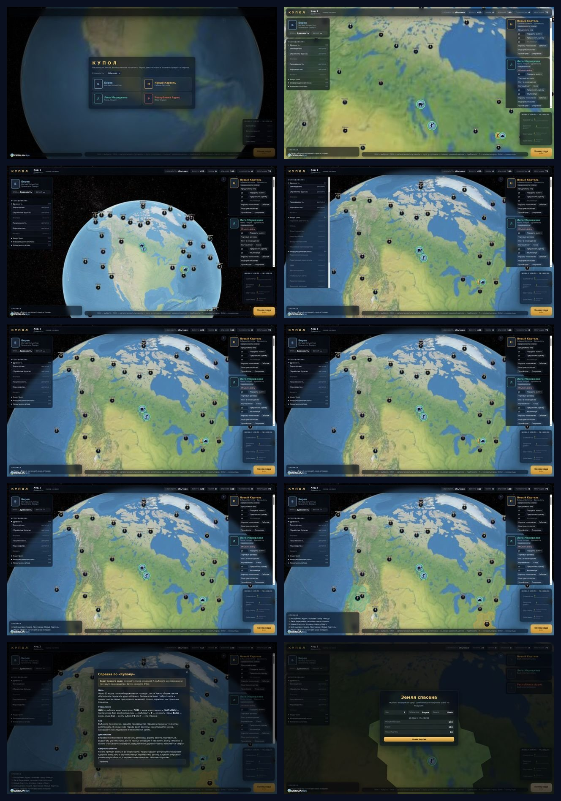
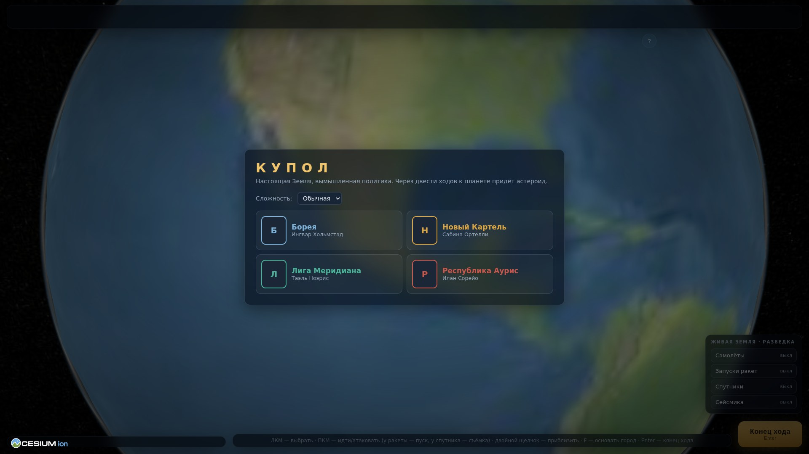
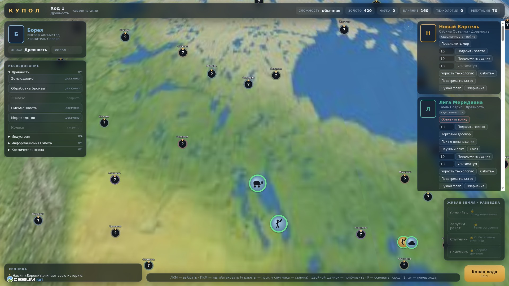
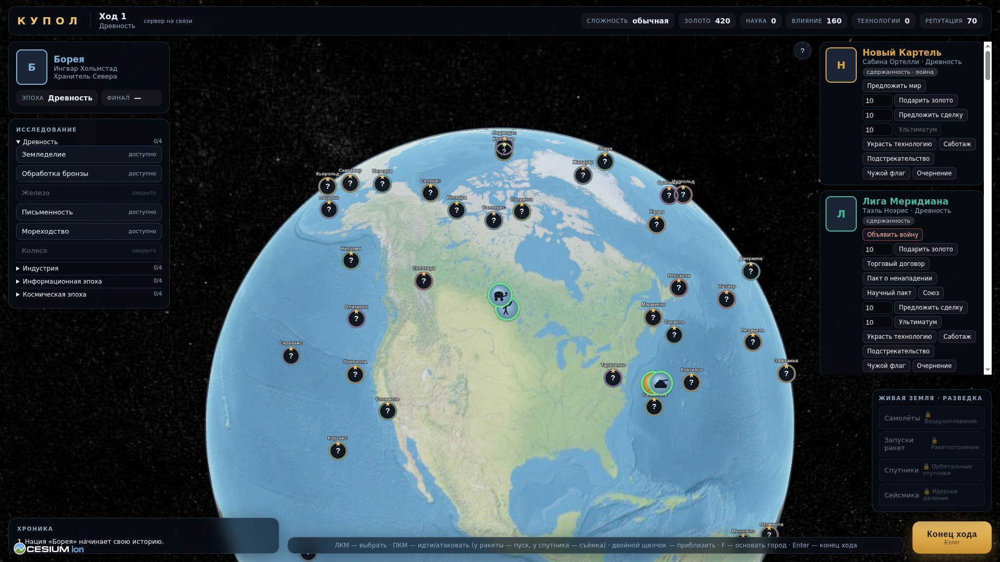
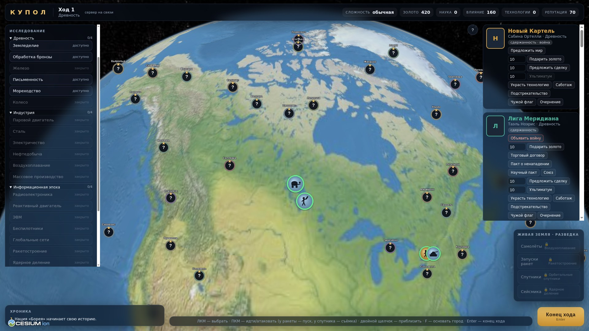
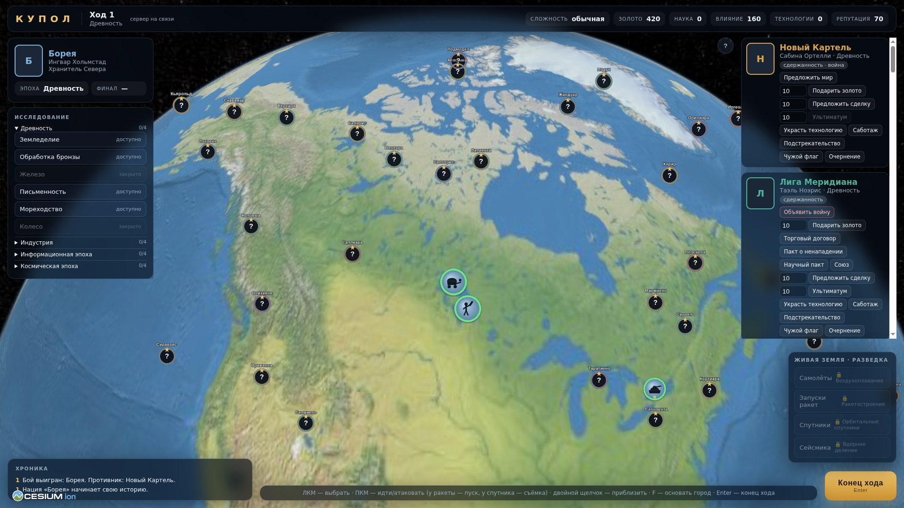
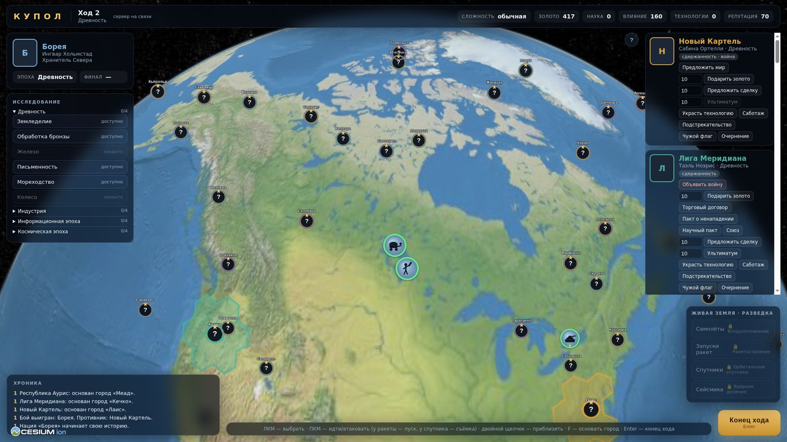
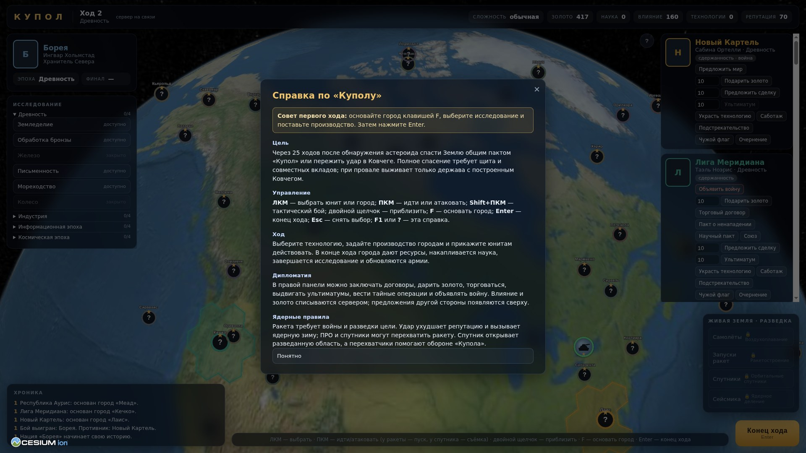
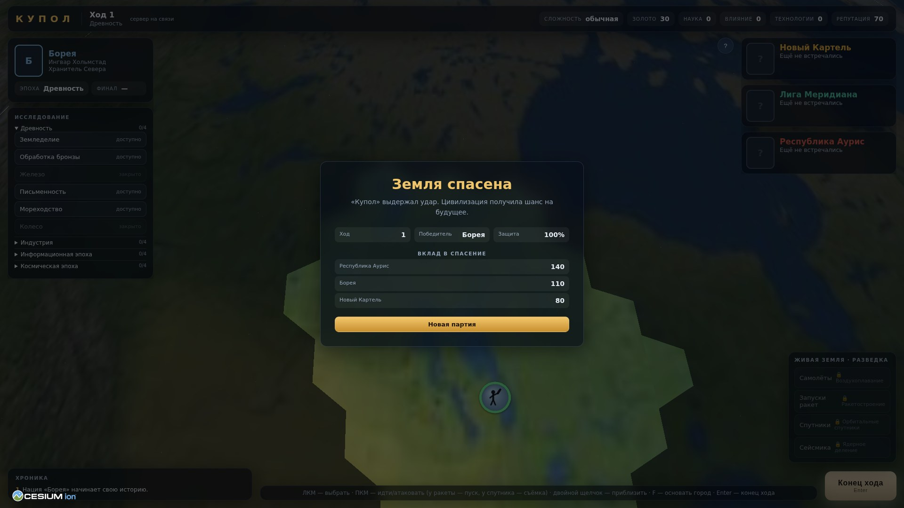

# «Купол» — скриншоты игры

Снято автоматически в Chrome, 1920×1080, без интернета (встроенный глобус).

## Выбор нации и сложности

## Начало партии: столица, панель города и дипломатии

## Вся Земля: выдуманные страны поверх настоящего рельефа

## Дерево технологий по эпохам

## Дипломатия: договоры, сделки, разведка, нейтральные народы

## Тактический бой в 3D

## Итог боя

## Второй ход: хроника событий

## Справка по игре

## Финал: «Земля спасена»

